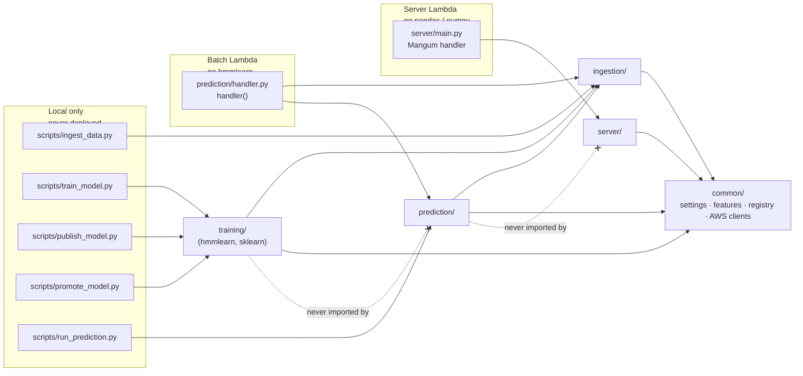
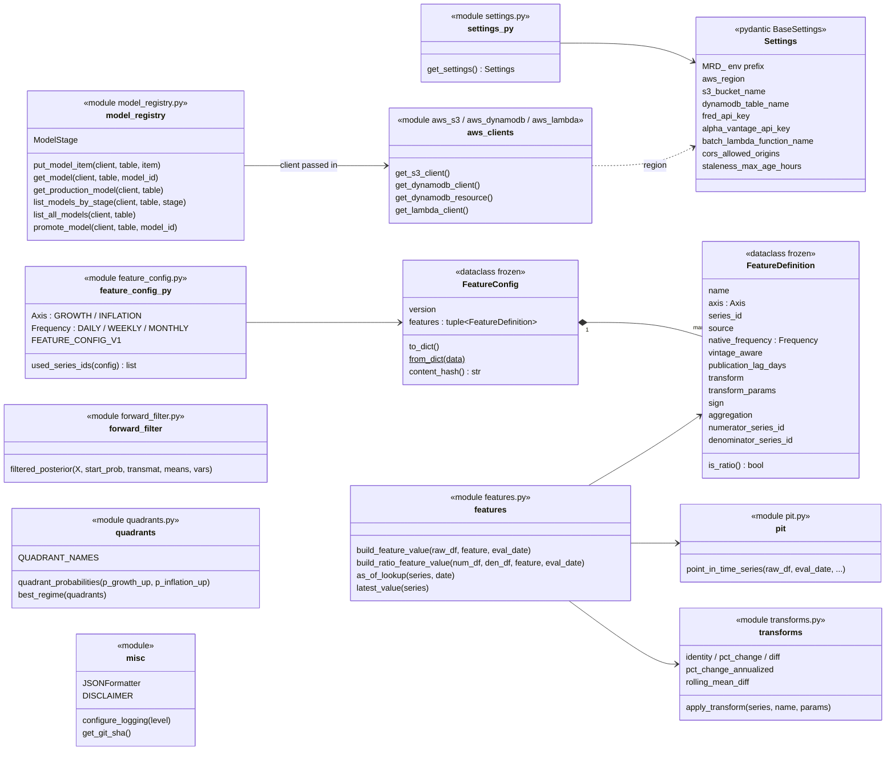
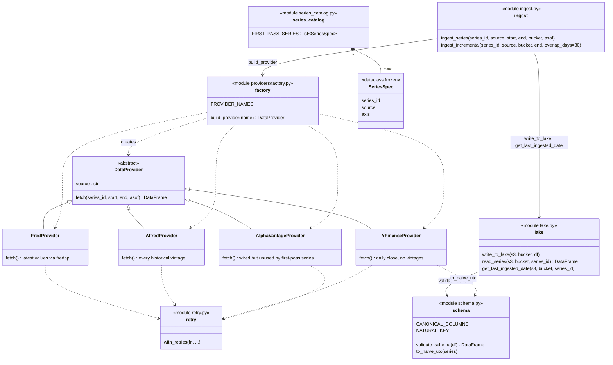
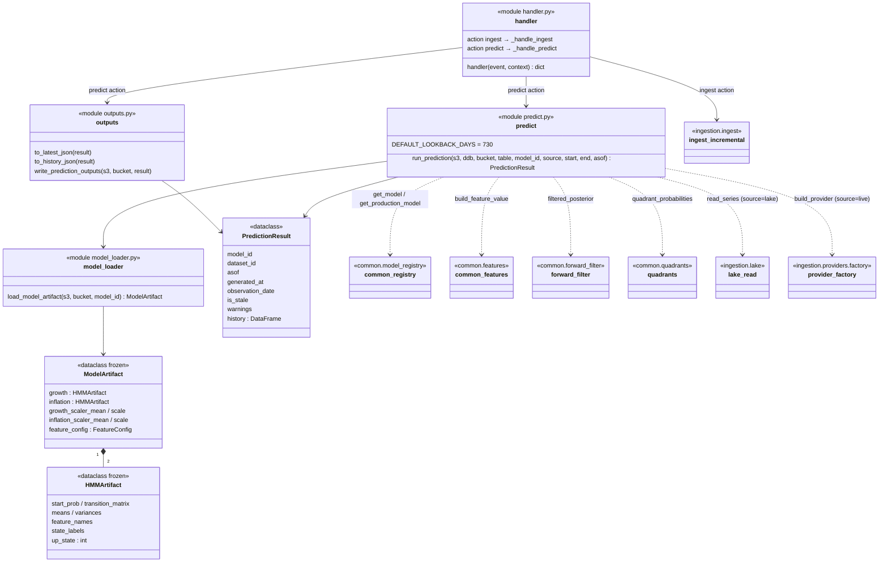
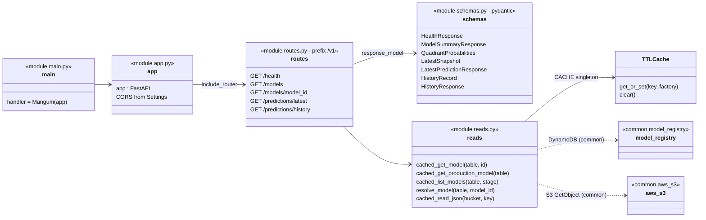
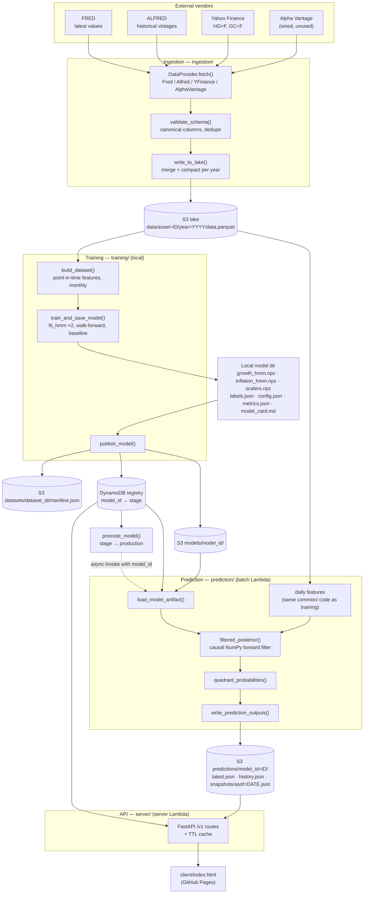
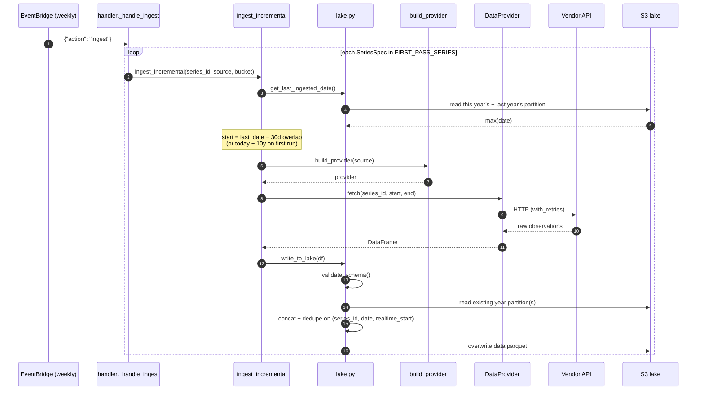
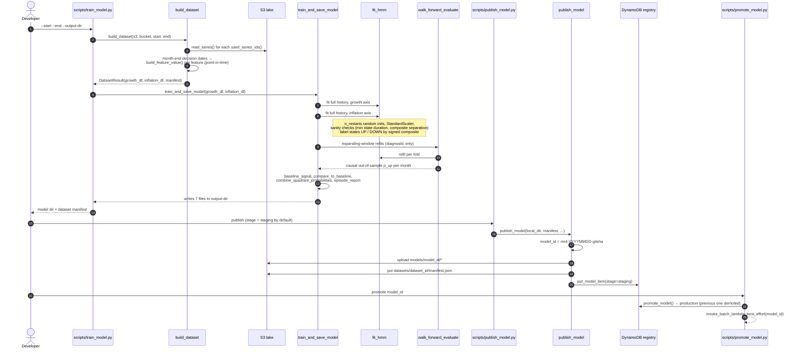
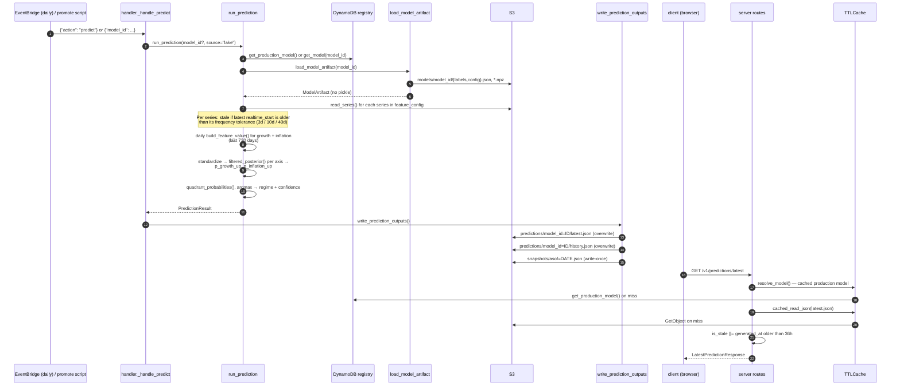

# Architecture

A map of where the code lives and how data moves through it. All diagrams are
[Mermaid](https://mermaid.js.org/) — GitHub renders them inline, and they're plain text
you can edit in place or paste into <https://mermaid.live> for a visual editor.

- [1. Deployables and import rules](#1-deployables-and-import-rules)
- [2. Code diagrams (C4 level 4)](#2-code-diagrams-c4-level-4)
- [3. Data flow](#3-data-flow)
- [4. S3 / DynamoDB layout](#4-s3--dynamodb-layout)
- [5. Where to find things](#5-where-to-find-things)

---

## 1. Deployables and import rules

Four things run, and the package boundaries exist to keep each one's dependency set small.

**Hard rules**

| Rule | Why |
|---|---|
| `prediction/` never imports `training/` | `training/trainer.py` imports `hmmlearn`, which the batch Lambda image excludes. Inference uses the pure-NumPy `common/forward_filter.py` instead. `prediction/predict.py` deliberately duplicates ~15 lines of axis-matrix assembly from `training/dataset.py` to respect this. |
| `server/` never imports `pandas` / `numpy` / `hmmlearn` | It is a zip Lambda that only reads JSON from S3 and items from DynamoDB. |
| Training reads the **lake only** | `training/dataset.py` never calls a provider; ingestion is the sole writer of `data/`. |
| Providers never write to S3 | `DataProvider.fetch` returns a DataFrame; `ingestion/ingest.py` + `lake.py` own validation and writes. |
| Models are plain `.npz` / `.json` | No pickle anywhere — `prediction/model_loader.py` rebuilds everything from NumPy arrays and JSON. |

---

## 2. Code diagrams (C4 level 4)

Each diagram covers one package. Module-level functions are shown as a `<<module>>` box
(Mermaid has no native "module" shape); dataclasses are shown as `<<dataclass>>`. Only
public classes and functions are listed — leading-underscore helpers are omitted.
Arrows read "uses".

### 2.1 `common/` — shared foundation

### 2.2 `ingestion/` — vendors → lake

### 2.3 `training/` — lake → published model (runs locally)

```mermaid
classDiagram
    direction TB

    class DatasetResult {
        <<dataclass>>
        growth_df
        inflation_df
        manifest : dict
    }
    class dataset {
        <<module dataset.py>>
        build_dataset(s3, bucket, start, end, feature_config) DatasetResult
    }

    class HMMHyperparameters {
        <<dataclass frozen>>
        n_restarts
        covariance_type
        min_state_duration_months
        composite_separation_margin
        initial_window_months
        refit_every_months
        random_state
        to_dict()
    }
    class build_model {
        <<module build_model.py>>
        DEFAULT_HYPERPARAMETERS
        train_and_save_model(output_dir, growth_df, inflation_df, feature_config, hyperparameters)
    }

    class FitResult {
        <<dataclass>>
        feature_names
        scaler_mean / scaler_scale
        start_prob / transition_matrix
        means / variances
        state_labels : UP or DOWN
        composites
        log_likelihood
    }
    class trainer {
        <<module trainer.py>>
        fit_hmm(df, feature_defs, n_restarts, ...) FitResult
    }
    class evaluation {
        <<module evaluation.py>>
        walk_forward_evaluate(df, feature_defs, ...) DataFrame
    }
    class baseline {
        <<module baseline.py>>
        baseline_signal(axis_df, feature_defs)
    }
    class report {
        <<module report.py>>
        compare_to_baseline(walk_forward, baseline)
        combine_quadrant_probabilities(growth, inflation)
        episode_report(quadrants, value_column)
        render_model_card(...)
    }
    class publisher {
        <<module publisher.py>>
        PublishStage
        publish_model(local_dir, manifest, s3, bucket, ddb, table, stage) model_id
    }
    class promote {
        <<module promote.py>>
        invoke_batch_lambda_best_effort(lambda_client, fn_name, model_id)
    }

    dataset --> DatasetResult
    build_model --> HMMHyperparameters
    build_model --> trainer : fit_hmm (full history, saved)
    build_model --> evaluation : walk_forward_evaluate (diagnostic only)
    build_model --> baseline
    build_model --> report
    trainer --> FitResult
    evaluation --> trainer : refit per fold
    evaluation ..> forward_filter : causal posteriors
    dataset ..> lake : read_series
    dataset ..> features : build_feature_value
    dataset ..> feature_config_py : used_series_ids
    publisher ..> model_registry : put_model_item
    promote ..> aws_lambda : async invoke

    class lake {
        <<ingestion.lake>>
    }
    class features {
        <<common.features>>
    }
    class feature_config_py {
        <<common.feature_config>>
    }
    class forward_filter {
        <<common.forward_filter>>
    }
    class model_registry {
        <<common.model_registry>>
    }
    class aws_lambda {
        <<AWS Lambda>>
    }
```

### 2.4 `prediction/` — batch Lambda (no `hmmlearn`)

### 2.5 `server/` — read-only API (server Lambda)

The route layer ORs the batch job's generation-time `is_stale` with a request-time
check (`generated_at` older than `Settings.staleness_max_age_hours`).

---

## 3. Data flow

### 3.1 End to end: vendors → lake → model → predictions → API

Schedules (EventBridge → batch Lambda, see `terraform/main.tf`):

| Rule | Cadence | Event | Does |
|---|---|---|---|
| ingest | Sun 05:00 UTC | `{"action": "ingest"}` | `ingest_incremental` for every series in `FIRST_PASS_SERIES` (per-series failures logged, not fatal) |
| predict | Mon–Fri 06:30 UTC | `{"action": "predict"}` | `run_prediction` off the lake, then `write_prediction_outputs`; **never ingests** |

### 3.2 Ingestion sequence

The 30-day overlap re-fetches a trailing window so recent revisions are picked up; the
dedupe key keeps the newest `ingested_at`, so re-running any range is idempotent.

### 3.3 Training sequence

Only the full-history fit is saved; the walk-forward fits exist to produce honest
out-of-sample metrics in `metrics.json` and `model_card.md`.

### 3.4 Prediction and serving sequence

---

## 4. S3 / DynamoDB layout

One versioned S3 bucket (`Settings.s3_bucket_name`) plus one DynamoDB table.

| Location | Written by | Read by | Contents |
|---|---|---|---|
| `s3://…/data/asset=<series_id>/year=<yyyy>/data.parquet` | `ingestion/lake.py::write_to_lake` | `read_series` (training, prediction) | Raw vintaged observations: `date, value, realtime_start, source, series_id, ingested_at` |
| `s3://…/datasets/<dataset_id>/manifest.json` | `training/publisher.py` | humans, audits | Dataset id, feature-config hash, date range, per-asset row counts and date ranges, warnings |
| `s3://…/models/<model_id>/` | `training/publisher.py` | `prediction/model_loader.py` | `growth_hmm.npz`, `inflation_hmm.npz`, `scalers.npz`, `labels.json`, `config.json`, `metrics.json`, `model_card.md` |
| `s3://…/predictions/model_id=<id>/latest.json` | `prediction/outputs.py` | `server/routes.py` | Latest quadrant probabilities, regime, confidence |
| `s3://…/predictions/model_id=<id>/history.json` | `prediction/outputs.py` | `server/routes.py` | Daily history over the lookback window |
| `s3://…/predictions/model_id=<id>/snapshots/asof=<date>.json` | `prediction/outputs.py` | humans | Write-once record of what was published for that as-of date |
| DynamoDB `models` table | `common/model_registry.py` (publisher, promote script) | `prediction/predict.py`, `server/reads.py` | `model_id` → `stage` (`development`/`staging`/`production`/`archived`), `dataset_id`, S3 URIs, summary metrics. Exactly one `production` item. |

---

## 5. Where to find things

| I want to… | Look at |
|---|---|
| Add or change a data series | `ingestion/series_catalog.py` (what to ingest) **and** `common/feature_config.py` (`FEATURE_CONFIG_V1` — how it becomes a feature) |
| Add a new data vendor | Subclass `DataProvider` in `ingestion/providers/`, register in `providers/factory.py` |
| Change a feature transform | `common/transforms.py` (`apply_transform`), referenced by name from `FeatureDefinition.transform` |
| Change point-in-time / publication-lag logic | `common/pit.py`, `common/features.py` |
| Change HMM fitting or its sanity checks | `training/trainer.py` (`fit_hmm`), hyperparameters in `training/build_model.py` |
| Change evaluation / model card | `training/evaluation.py`, `training/baseline.py`, `training/report.py` |
| Change how inference works | `common/forward_filter.py`, `prediction/predict.py` |
| Change the published JSON shape | `prediction/outputs.py` **and** `server/schemas.py` (keep in sync) |
| Add an API endpoint | `server/routes.py`, `server/schemas.py`, `server/reads.py` |
| Change schedules, IAM, Lambdas | `terraform/main.tf`, `docker/batch-lambda.Dockerfile`, `scripts/package_lambda.sh` |
| Change CI/CD | `.github/workflows/deploy-terraform.yml`, `deploy-client.yml` |
| Run something by hand | `scripts/` — `ingest_data.py`, `train_model.py`, `publish_model.py`, `promote_model.py`, `run_prediction.py` (thin wrappers, no logic of their own) |

Tests mirror the source tree: `tests/common`, `tests/ingestion` (+ `providers/`),
`tests/training`, `tests/prediction`, `tests/server`.
