# Architecture

A map of where the code lives and how data moves through it. All diagrams are
[Mermaid](https://mermaid.js.org/) — GitHub renders them inline, and they're plain text
you can edit in place or paste into <https://mermaid.live> for a visual editor.

- [1. Deployables and import rules](#1-deployables-and-import-rules)
- [2. Code diagrams (C4 level 4)](#2-code-diagrams-c4-level-4)
- [3. Data flow](#3-data-flow)
- [4. S3 / DynamoDB layout](#4-s3--dynamodb-layout)
- [5. Where to find things](#5-where-to-find-things)
- [6. HMM glossary](#6-hmm-glossary)
- [7. Training walkthrough](#7-training-walkthrough)

---

## 1. Deployables and import rules

Four things run, and the package boundaries exist to keep each one's dependency set small.

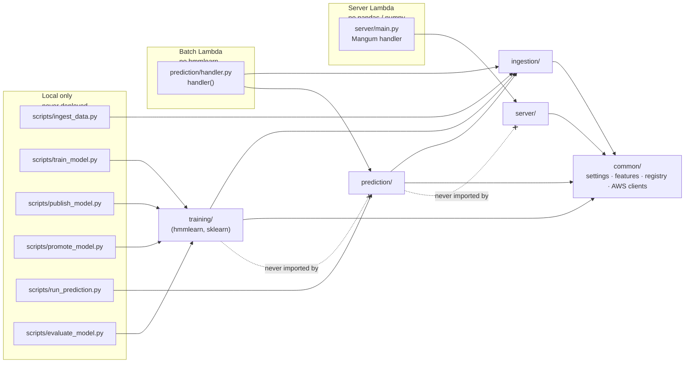

**Hard rules**

| Rule | Why |
|---|---|
| `prediction/` never imports `training/` | `training/trainer.py` imports `hmmlearn`, which the batch Lambda image excludes. Inference uses the pure-NumPy `common/forward_filter.py` instead. `prediction/predict.py` deliberately duplicates ~15 lines of axis-matrix assembly from `training/dataset.py` to respect this. |
| `server/` never imports `pandas` / `numpy` / `hmmlearn` | It is a zip Lambda that only reads JSON from S3 and items from DynamoDB. |
| Training reads the **lake only** | `training/dataset.py` never calls a provider; ingestion is the sole writer of `data/`. |
| Providers never write to S3 | `DataProvider.fetch` returns a DataFrame; `ingestion/ingest.py` + `lake.py` own validation and writes. |
| Models are plain `.npz` / `.json` | No pickle anywhere — `prediction/model_loader.py` rebuilds everything from NumPy arrays and JSON. |

---

## 2. Code diagrams (C4 level 4)

Each diagram covers one package. Module-level functions are shown as a `<<module>>` box
(Mermaid has no native "module" shape); dataclasses are shown as `<<dataclass>>`. Only
public classes and functions are listed — leading-underscore helpers are omitted.
Arrows read "uses".

### 2.1 `common/` — shared foundation

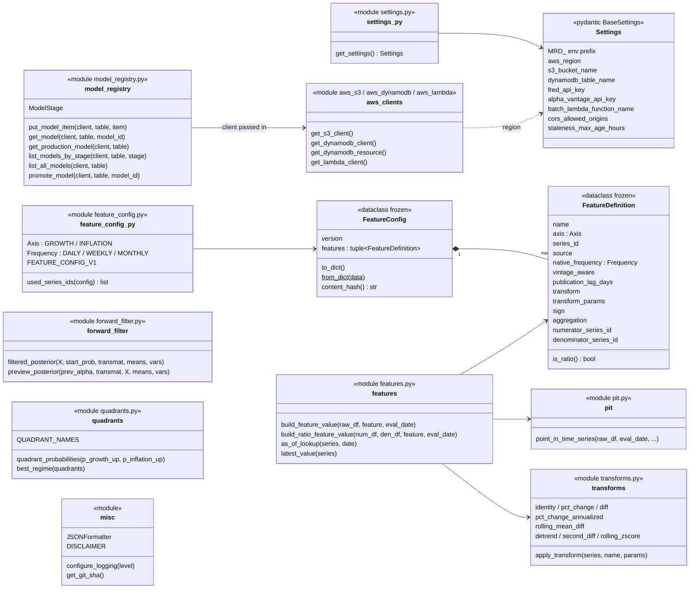

### 2.2 `ingestion/` — vendors → lake

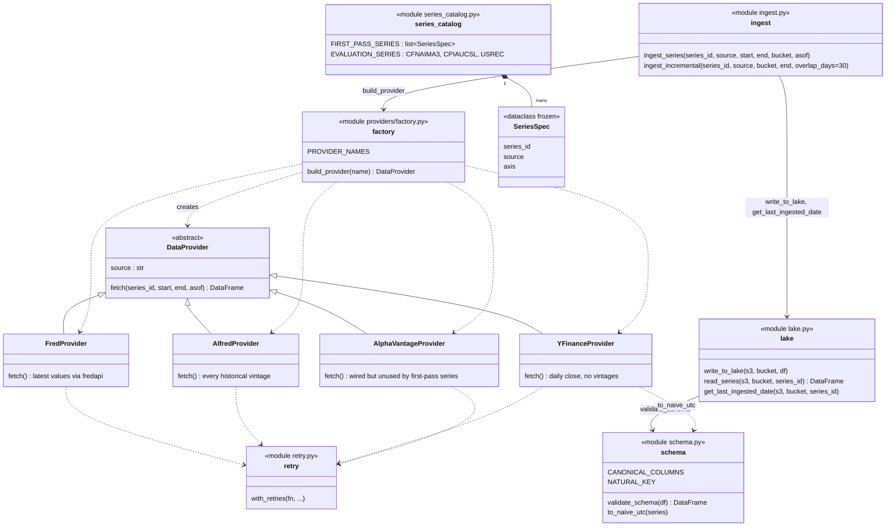

### 2.3 `training/` — lake → published model (runs locally)

```mermaid
classDiagram
    direction TB

    class DatasetResult {
        <<dataclass>>
        growth_df
        inflation_df
        manifest : dict
    }
    class dataset {
        <<module dataset.py>>
        build_dataset(s3, bucket, start, end, feature_config) DatasetResult
    }

    class HMMHyperparameters {
        <<dataclass frozen>>
        n_restarts
        covariance_type
        min_state_duration_months
        composite_separation_margin
        initial_window_months
        refit_every_months
        random_state
        to_dict()
    }
    class build_model {
        <<module build_model.py>>
        DEFAULT_HYPERPARAMETERS
        train_and_save_model(output_dir, growth_df, inflation_df, feature_config, hyperparameters)
    }

    class FitResult {
        <<dataclass>>
        feature_names
        scaler_mean / scaler_scale / scaler_clip / scaler_method
        start_prob / transition_matrix
        means / variances
        state_labels : UP or DOWN
        composites
        log_likelihood
    }
    class trainer {
        <<module trainer.py>>
        fit_hmm(df, feature_defs, n_restarts, ...) FitResult
    }
    class scaling {
        <<common.scaling>>
        DEFAULT_CLIP
        fit_robust_scaler(X, clip, method) center, scale
        apply_scaler(X, center, scale, clip)
    }
    class evaluation {
        <<module evaluation.py>>
        walk_forward_evaluate(df, feature_defs, ...) DataFrame
    }
    class baseline {
        <<module baseline.py>>
        baseline_signal(axis_df, feature_defs)
    }
    class report {
        <<module report.py>>
        compare_to_baseline(walk_forward, baseline)
        combine_quadrant_probabilities(growth, inflation)
        episode_report(quadrants, value_column)
        render_model_card(...)
    }
    class LabelSet {
        <<dataclass frozen>>
        growth
        growth_recession
        inflation
        label_lag_months
    }
    class labels {
        <<module labels.py>>
        growth_label(cfnai_ma3)
        recession_label(usrec)
        inflation_label(cpi)
        build_label_set(cfnai, usrec, cpi) LabelSet
    }
    class benchmarks {
        <<module benchmarks.py>>
        climatology_baseline(...)
        calibrated_persistence_baseline(...)
        fixed_rule_baseline(...)
        logistic_baseline(...)
    }
    class scoring {
        <<module scoring.py>>
        log_loss / brier / skill_score
        auc / accuracy
        calibration_table
        block_bootstrap_ci
        flip_rate_per_year
        mean_regime_duration_months
        detection_lag
    }
    class harness {
        <<module harness.py>>
        MODEL_NAMES
        run_evaluation(growth_df, inflation_df, labels, feature_config, hp, dev_end, include_holdout) dict
        render_evaluation_markdown(report, metadata) str
    }
    class occupancy {
        <<module occupancy.py>>
        build_occupancy_report(walk_forward_result) dict
    }
    class publisher {
        <<module publisher.py>>
        PublishStage
        publish_model(local_dir, manifest, s3, bucket, ddb, table, stage) model_id
    }
    class promote {
        <<module promote.py>>
        invoke_batch_lambda_best_effort(lambda_client, fn_name, model_id)
    }

    dataset --> DatasetResult
    labels --> LabelSet
    harness --> LabelSet
    harness --> benchmarks : 4 causal baselines
    harness --> scoring
    harness --> evaluation : HMM walk-forward
    harness --> occupancy : per-axis state-occupancy report
    harness --> build_model : HMMHyperparameters
    build_model --> HMMHyperparameters
    build_model --> trainer : fit_hmm (full history, saved)
    build_model --> evaluation : walk_forward_evaluate (diagnostic only)
    build_model --> baseline
    build_model --> report
    trainer --> FitResult
    trainer ..> scaling : fit_robust_scaler / apply_scaler
    evaluation --> trainer : refit per fold
    evaluation ..> scaling : apply_scaler (scoring time)
    benchmarks ..> scaling : logistic baseline
    evaluation ..> forward_filter : causal posteriors
    dataset ..> lake : read_series
    dataset ..> features : build_feature_value
    dataset ..> feature_config_py : used_series_ids
    publisher ..> model_registry : put_model_item
    promote ..> aws_lambda : async invoke

    class lake {
        <<ingestion.lake>>
    }
    class features {
        <<common.features>>
    }
    class feature_config_py {
        <<common.feature_config>>
    }
    class forward_filter {
        <<common.forward_filter>>
    }
    class model_registry {
        <<common.model_registry>>
    }
    class aws_lambda {
        <<AWS Lambda>>
    }
```

### 2.4 `prediction/` — batch Lambda (no `hmmlearn`)

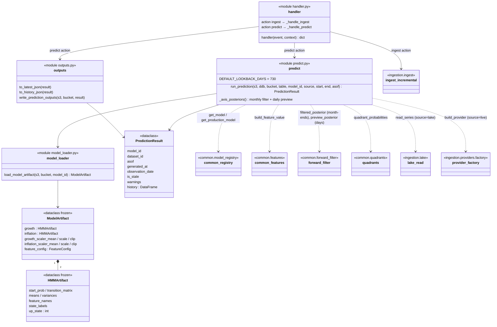

### 2.5 `server/` — read-only API (server Lambda)

The route layer ORs the batch job's generation-time `is_stale` with a request-time
check (`generated_at` older than `Settings.staleness_max_age_hours`).

---

## 3. Data flow

### 3.1 End to end: vendors → lake → model → predictions → API

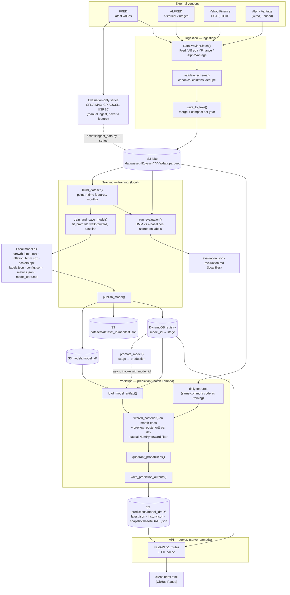

Schedules (EventBridge → batch Lambda, see `terraform/main.tf`):

| Rule | Cadence | Event | Does |
|---|---|---|---|
| ingest | Daily 04:00 UTC | `{"action": "ingest"}` | `ingest_incremental` for every series in `FIRST_PASS_SERIES` (per-series failures logged, not fatal) |
| predict | Daily 06:00 UTC | `{"action": "predict"}` | `run_prediction` off the lake, then `write_prediction_outputs`; **never ingests** |

### 3.2 Ingestion sequence

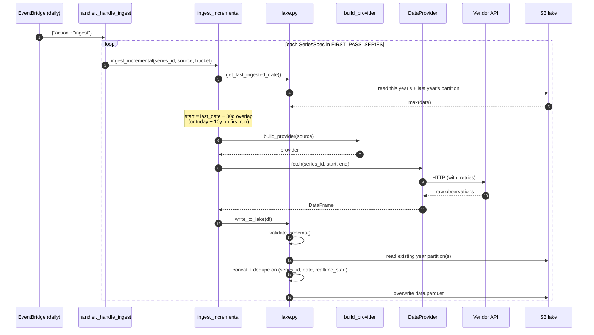

The daily ingest job iterates `FIRST_PASS_SERIES` only. The three `EVALUATION_SERIES`
(ground-truth labels for scoring) are ingested by hand with
`scripts/ingest_data.py --series CFNAIMA3 CPIAUCSL USREC` and are never used as model features.

The 30-day overlap re-fetches a trailing window so recent revisions are picked up; the
dedupe key keeps the newest `ingested_at`, so re-running any range is idempotent.

### 3.3 Training sequence

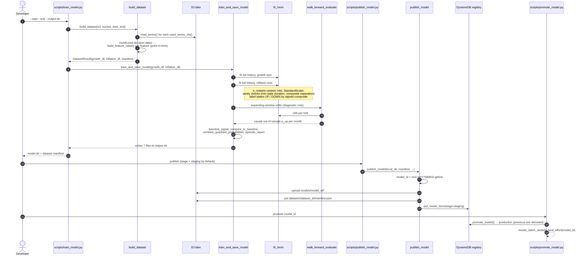

Separately, `scripts/evaluate_model.py` measures a named configuration without
changing it: `--feature-config` selects a `FeatureConfig` by version from
`common.feature_config.FEATURE_CONFIGS` (default `v1`). It builds the dataset for
that config, reads the label series from the lake (`build_label_set`), and calls
`run_evaluation`, which scores the HMM's walk-forward posteriors against four
causal baselines (climatology, calibrated persistence, fixed rule, logistic) on
dev/holdout splits. It writes `evaluation.json` and `evaluation.md` locally and
publishes nothing — see `docs/model_cards/v3/MODEL_CARD.md` for the model's
development history and reference evaluation runs.

**What `run_evaluation` actually measures, per axis and per split (dev/holdout/all):**
log loss, Brier score, skill vs. climatology with a block-bootstrapped 95% CI
(`harness._skill_ci`, 6-month blocks), AUC, accuracy, expected calibration error
plus the full calibration table, flip rate per year, and mean regime duration —
for all five "models" (climatology, persistence, rule, logistic, hmm_current) on
the **same-month comparability intersection** (a model's own raw coverage before
that intersection is reported separately under `coverage`, never silently
dropped). Quadrant-level log loss needs both axes' predictions and both axes'
true labels on the same month, so it's computed on its own, narrower
intersection. Recession detection lag (growth axis only, vs. `USREC`) and every
walk-forward fold any model's HMM/logistic fit skipped (with why) round out the
report.

**State-occupancy report** (`training/occupancy.build_occupancy_report`, one per
axis, independent of dev/holdout): answers "is a state just one episode?"
directly rather than leaving it implicit in `flip_rate_per_year`. `overall`
groups every evaluated month by its assigned UP/DOWN label across *all* folds —
meaningful despite each fold refitting its own HMM, since the label comes from
that fold's own composite score (brief section 2.3), not an arbitrary state
index. `by_fold` keeps each fold's own per-feature emission means in z-units
(`walk_forward_evaluate`'s `fold_fits` attr) plus that fold's own occupancy
fraction, so a state that only shows up because one feature's value is extreme
in one fold is visible fold by fold, not just smoothed into the aggregate.

Only the full-history fit is saved; the walk-forward fits exist to produce honest
out-of-sample metrics in `metrics.json` and `model_card.md`.

### 3.4 Prediction and serving sequence

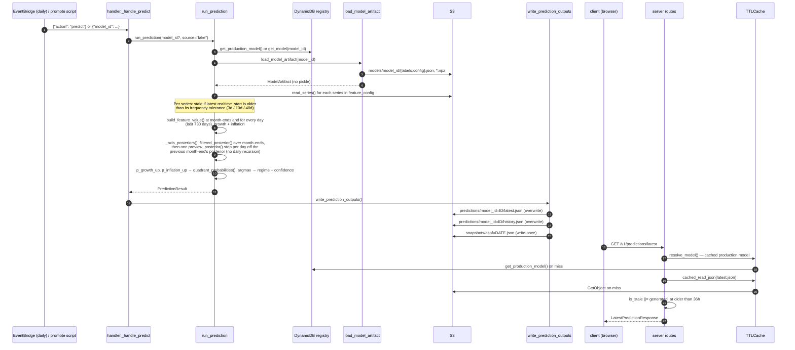

---

## 4. S3 / DynamoDB layout

One versioned S3 bucket (`Settings.s3_bucket_name`) plus one DynamoDB table.

| Location | Written by | Read by | Contents |
|---|---|---|---|
| `s3://…/data/asset=<series_id>/year=<yyyy>/data.parquet` | `ingestion/lake.py::write_to_lake` | `read_series` (training, prediction) | Raw vintaged observations: `date, value, realtime_start, source, series_id, ingested_at` |
| `s3://…/datasets/<dataset_id>/manifest.json` | `training/publisher.py` | humans, audits | Dataset id, feature-config hash, date range, per-asset row counts and date ranges, warnings |
| `s3://…/models/<model_id>/` | `training/publisher.py` | `prediction/model_loader.py` | `growth_hmm.npz`, `inflation_hmm.npz`, `scalers.npz`, `labels.json`, `config.json`, `metrics.json`, `model_card.md` |
| `s3://…/predictions/model_id=<id>/latest.json` | `prediction/outputs.py` | `server/routes.py` | Latest quadrant probabilities, regime, confidence |
| `s3://…/predictions/model_id=<id>/history.json` | `prediction/outputs.py` | `server/routes.py` | Daily history over the lookback window |
| `s3://…/predictions/model_id=<id>/snapshots/asof=<date>.json` | `prediction/outputs.py` | humans | Write-once record of what was published for that as-of date |
| DynamoDB `models` table | `common/model_registry.py` (publisher, promote script) | `prediction/predict.py`, `server/reads.py` | `model_id` → `stage` (`development`/`staging`/`production`/`archived`), `dataset_id`, S3 URIs, summary metrics. Exactly one `production` item. |

---

## 5. Where to find things

| I want to… | Look at |
|---|---|
| Add or change a data series | `ingestion/series_catalog.py` (what to ingest) **and** `common/feature_config.py` (`FEATURE_CONFIG_V1` — how it becomes a feature) |
| Add a new data vendor | Subclass `DataProvider` in `ingestion/providers/`, register in `providers/factory.py` |
| Change a feature transform | `common/transforms.py` (`apply_transform`), referenced by name from `FeatureDefinition.transform` |
| Change point-in-time / publication-lag logic | `common/pit.py`, `common/features.py` |
| Change HMM fitting or its sanity checks | `training/trainer.py` (`fit_hmm`), hyperparameters in `training/build_model.py` |
| Change evaluation / model card | `training/evaluation.py`, `training/baseline.py`, `training/report.py` |
| Change how inference works | `common/forward_filter.py` (`filtered_posterior`, `preview_posterior`), `prediction/predict.py` (`_axis_posteriors`) |
| Score a model against baselines | `scripts/evaluate_model.py --feature-config <version>` → `training/harness.py`, `benchmarks.py`, `scoring.py`, `labels.py`, `occupancy.py`; label series in `ingestion/series_catalog.py` (`EVALUATION_SERIES`) |
| Evaluate a new `FeatureConfig` version | Register it in `common/feature_config.py`'s `FEATURE_CONFIGS` dict, then `scripts/evaluate_model.py --feature-config <version>` — no other script change needed |
| Change the published JSON shape | `prediction/outputs.py` **and** `server/schemas.py` (keep in sync) |
| Add an API endpoint | `server/routes.py`, `server/schemas.py`, `server/reads.py` |
| Change schedules, IAM, Lambdas | `terraform/main.tf`, `docker/batch-lambda.Dockerfile`, `scripts/package_lambda.sh` |
| Change CI/CD | `.github/workflows/deploy-terraform.yml`, `deploy-client.yml` |
| Run something by hand | `scripts/` — `ingest_data.py`, `train_model.py`, `evaluate_model.py`, `publish_model.py`, `promote_model.py`, `run_prediction.py` (thin wrappers, no logic of their own) |
| Understand how the current feature config/model got here | `docs/model_cards/v3/MODEL_CARD.md` — the 8-phase accuracy-improvement plan's full history: decisions, ablation tables, bugs found and fixed |

Tests mirror the source tree: `tests/common`, `tests/ingestion` (+ `providers/`),
`tests/training`, `tests/prediction`, `tests/server`.

---

## 6. HMM glossary

Each axis (growth, inflation) has two hidden states, UP and DOWN. They are never observed
directly; only the features (payrolls, copper, yield spreads, …) are.

| Term | Meaning |
|---|---|
| **Posterior** | Updated belief about the hidden state after seeing data, e.g. `P(state = UP \| features)`. A probability, not a hard label. The repo's `p_growth_up` / `p_inflation_up` are the UP entry of this vector. |
| **Prior** | The belief before seeing the new data. |
| **Transition matrix** | Probability of moving between states in one step. Learned on **monthly** steps. |
| **Emission** | How likely a given feature vector is under each state (a diagonal Gaussian per state). |
| **Filtered posterior** | Posterior conditioned on observations up to time *t* only. Causal: no peeking at the future. Computed by the forward algorithm in `common/forward_filter.py::filtered_posterior`. |
| **Smoothed posterior** | Posterior conditioned on *all* observations, including later ones (what `hmmlearn.predict_proba` returns). More accurate in hindsight but look-ahead, so the repo never uses it for evaluation or prediction. |
| **Preview posterior** | Repo-specific term. One predict-and-update step off a fixed prior, applied independently to each row. See below. |

**Filtering** is recursive: each step (1) *predicts* by pushing last step's belief through
the transition matrix, then (2) *updates* by multiplying by how well the new features fit
each state and renormalizing. The result becomes the next step's prior.

**Why a preview?** The transition matrix is monthly, but predictions are wanted daily.
Running the recursive filter daily would apply a month of transition probability about 30
times a month and re-count near-identical evidence, saturating probabilities. Instead,
`prediction/predict.py::_axis_posteriors` runs the real filter on month-end rows only, then
gives every day one `preview_posterior` step from the **previous** month-end's posterior,
using that day's own features. Days never chain into each other.

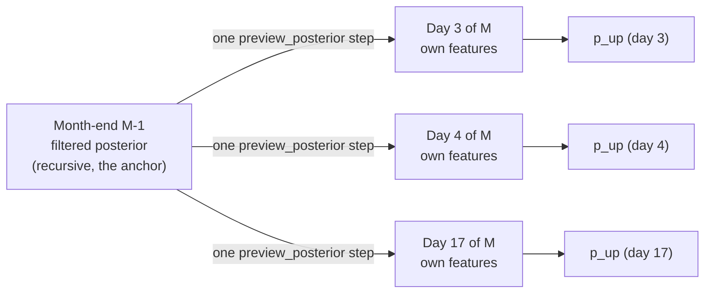

Notes: the first partial month of the lookback window has no anchor and is dropped. On a
day that is itself a month-end, the preview equals the filtered result (same single step).

---

## 7. Training walkthrough

This is not neural-network training: there are **no epochs, mini-batches or validation
loss**. A Gaussian HMM is fitted by the EM algorithm (Baum-Welch) on one small table of
numbers, a few hundred rows by 5 columns per axis. "Validation" is a **walk-forward
backtest**, not a train/validation split.

### 7.1 Lake → one row of the feature matrix

`build_dataset` loops over month-end **decision dates**. For each date and each feature it
runs the same pipeline (`common/features.py`), using only what was knowable on that date.

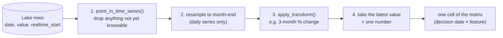

**Step 1 depends on the series type:**

- *Vintage-aware (ALFRED: INDPRO, PAYEMS, ICSA, CPILFESL):* keep rows with
  `realtime_start <= decision date`, and per observation date keep the latest revision known
  by then. Revisions and publication delays are handled by `realtime_start`.
- *Non-vintage (FRED market series, yfinance):* keep rows where
  `date + publication_lag_days <= decision date`.

**Worked example** (illustrative numbers): `payems_3m_change` on decision date 2024-06-30.

| Lake row (observation date) | `realtime_start` | Knowable on 2024-06-30? |
|---|---|---|
| 2024-06-01 (June payrolls) | 2024-07-05 | No, not published yet |
| 2024-05-01 | 2024-06-07 | Yes |
| 2024-04-01 | 2024-05-03 | Yes |
| 2024-02-01 | 2024-03-08, revised 2024-04-05 | Yes, the 2024-04-05 revision |

After step 1 the series ends at May. Step 3 (`pct_change`, 3 periods) gives May vs. February,
and step 4 returns that last value. Rows for series that are not yet long enough for their
transform come back empty and are dropped, so the effective start date is whatever the data
allows.

The result for one axis is a table with one row per month-end and one column per feature:

| decision_date | indpro_3m_change | payems_3m_change | icsa_4wk_avg_change | t10y2y_level | copper_gold_3m_momentum |
|---|---|---|---|---|---|
| 2024-04-30 | 0.004 | 0.006 | -2 500 | 0.35 | 0.021 |
| 2024-05-31 | 0.003 | 0.005 | 1 250 | 0.30 | -0.012 |
| 2024-06-30 | 0.002 | 0.004 | 3 000 | 0.27 | 0.008 |

The inflation axis has its own 5 columns (core CPI, two breakeven changes, real yield, oil).
The `sign` field on each feature (+1 if higher means "up" for that axis, e.g. -1 for jobless
claims) is not applied here; it is only used later to label states.

### 7.2 What happens inside one `fit_hmm` call

Input: one axis's table (or a slice of it). Everything below is per axis, so growth and
inflation are fitted independently.

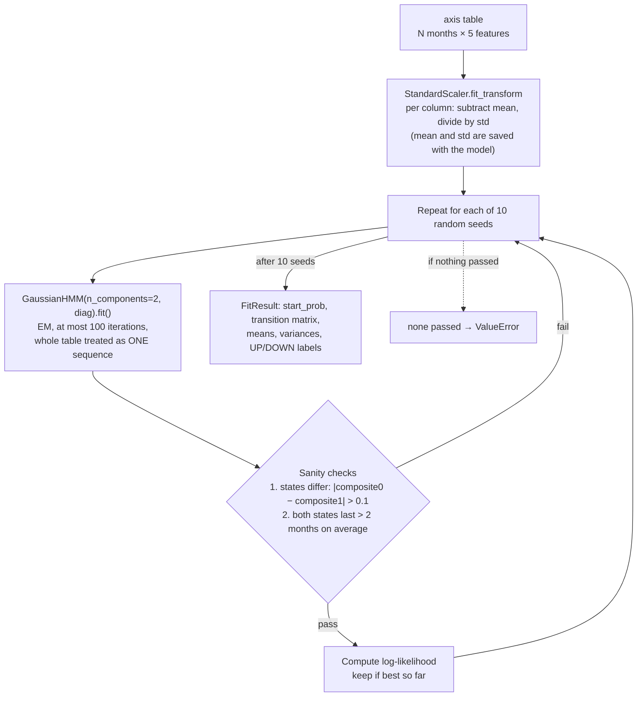

- **Passed in:** the standardized N×5 matrix, in date order. The HMM only learns the 2-state
  structure from this. It sees no labels.
- **"Steps":** each seed runs EM until it converges or hits 100 iterations. Each iteration is
  one pass over all N rows (forward-backward, then parameter update). That is the closest
  thing to an "epoch".
- **Learned:** `start_prob` (2), `transition_matrix` (2×2), `means` (2×5), `variances` (2×5).
- **UP / DOWN labelling:** for each state, composite = mean over features of (state mean ×
  feature sign). The state with the higher composite is UP. No label switching is possible.

### 7.3 How many fits happen, and on what data

`train_and_save_model` is run once per `train_model.py` call. For **each axis** it does:

1. **One full-history fit** on all N rows. **This is the only model that is saved.**
2. **Walk-forward evaluation**: an expanding window, refit every 12 months. These fits are
   diagnostic only and never saved.

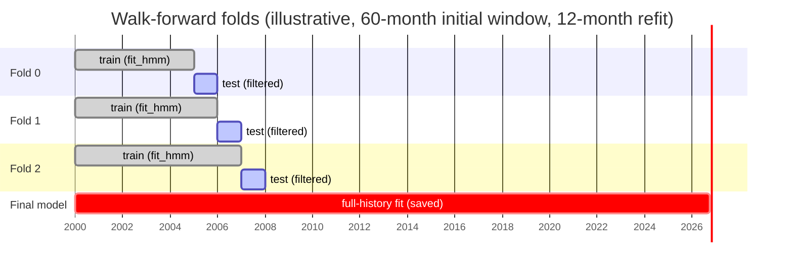

For each fold: `fit_hmm` on the train rows only, then standardize the **test** rows with that
fold's own scaler, run `filtered_posterior` over them, and record `p_up` per month. A fold
whose training window no longer shows two distinct regimes is skipped and recorded, not fatal.

**Rough count** (N ≈ 300 months, i.e. ~25 years of data):

| What | Count |
|---|---|
| Walk-forward folds per axis | ⌈(N − 60) / 12⌉ ≈ 20 |
| `fit_hmm` calls per axis | 20 folds + 1 full = 21 |
| EM runs per axis | 21 × 10 seeds = 210, each ≤ 100 iterations |
| Both axes | ≈ 42 `fit_hmm` calls, ≈ 420 EM runs |

Everything after fitting is cheap NumPy. `evaluate_model.py` repeats the walk-forward
fits once more inside `run_evaluation` for its own scoring, plus a logistic baseline.

### 7.4 What each stage is given

| Stage | Input | Output |
|---|---|---|
| `build_dataset` | Lake rows, decision dates (month-ends), `FEATURE_CONFIG_V1` | `growth_df`, `inflation_df` (N×5 each), manifest |
| `fit_hmm` (full) | One axis table, all rows | `FitResult` → saved as `*_hmm.npz`, `scalers.npz`, `labels.json` |
| `walk_forward_evaluate` | One axis table | Per-month out-of-sample `p_up` (never saved as a model) |
| `baseline_signal` | One axis table | Sign-of-composite UP/DOWN per month, used as a naive benchmark |
| `compare_to_baseline`, `episode_report` | Walk-forward `p_up` + baseline | `metrics.json`, `model_card.md` |
| `run_evaluation` (separate script) | Both tables + label series (CFNAI, USREC, CPI) | Dev / holdout scores vs. 4 baselines |

Out-of-sample here means "the model was fitted only on earlier months". There is no random
shuffling, because that would leak the future in time-series data.
